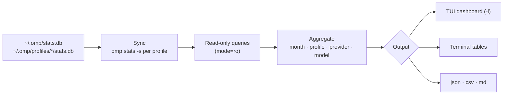
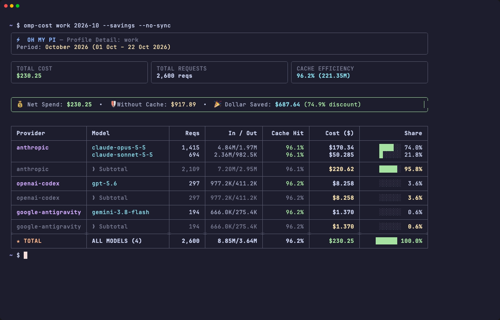
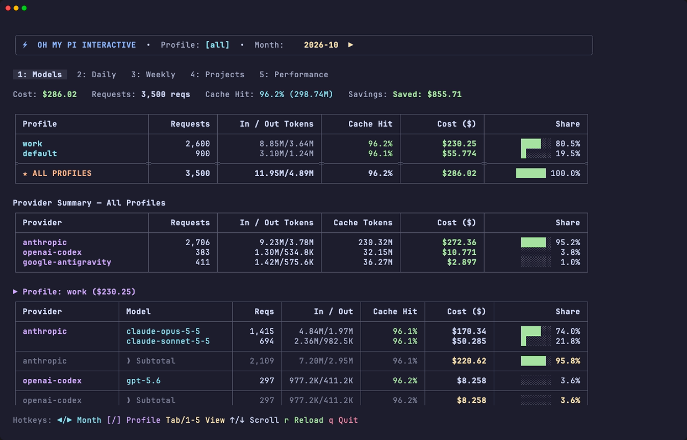

<p align="center">
  <picture>
    <source media="(prefers-color-scheme: dark)" srcset="docs/assets/logo-dark.svg">
    
  </picture>
</p>

<p align="center">
  <strong>AI token usage, prompt-cache savings, and cost per Oh My Pi profile, in your terminal.</strong><br>
  One CGO-free binary for Linux, macOS, and Windows.
</p>

<p align="center">
  <a href="https://github.com/faridlamaul/omp-cost/actions/workflows/ci.yml"></a>
  <a href="https://github.com/faridlamaul/omp-cost/actions/workflows/release.yml"></a>
  <a href="https://github.com/faridlamaul/omp-cost/releases/latest"></a>
  <a href="https://golang.org"></a>
  <a href="https://opensource.org/licenses/MIT"></a>
</p>

<p align="center">
  
</p>

omp-cost reads the usage that Oh My Pi records in each profile's `stats.db`. It reports requests, tokens, prompt-cache hit rate, and cost by calendar month, profile, provider, and model. It also attributes spend to repositories and agent roles, measures latency per model, and forecasts the month-end bill.

- **All profiles at once:** `default` and every profile under `~/.omp/profiles/`, with per-profile detail and a combined provider summary.
- **Cache ROI:** what you paid, what the same traffic would have cost without prompt caching, and the difference.
- **Attribution:** spend per repository (`--by-project`) and per agent role (`--by-agent`): main orchestrator, subagents, and advisors.
- **Read-only and local:** databases are opened with `mode=ro`, so reports run while agents are writing, and nothing is sent over the network.
- **Any output:** a full-screen TUI, terminal tables, or `json`, `csv`, and `md` for scripts, spreadsheets, and pull requests.

<details>
<summary><strong>Contents</strong></summary>

- [How it works](#how-it-works)
- [Installation](#installation)
- [Quick start](#quick-start)
- [Usage](#usage)
- [Reports](#reports)
- [Interactive mode](#interactive-mode)
- [Exporting data](#exporting-data)
- [CLI reference](#cli-reference)
- [Architecture](#architecture)
- [Releases](#releases)
- [Contributing](#contributing)
- [Ownership](#ownership)
- [License](#license)

</details>

## How it works



Before a report, omp-cost runs `omp stats -s` for every profile in parallel (4 s timeout each) so the databases include the latest sessions. `--no-sync` skips that step and answers in milliseconds from what is already recorded. omp-cost itself never writes to the databases.

## Installation

```bash
curl -fsSL https://raw.githubusercontent.com/faridlamaul/omp-cost/main/install.sh | bash  # latest release into ~/.local/bin
go install github.com/faridlamaul/omp-cost/cmd/omp-cost@latest                         # Go 1.26+
```

Prebuilt binaries for Linux, macOS, and Windows (amd64 and arm64) are attached to every [GitHub Release](https://github.com/faridlamaul/omp-cost/releases) together with a cosign-signed `checksums.txt`. The installer does not check the signature; to verify a download yourself:

```bash
gh release download -R faridlamaul/omp-cost -p 'checksums.txt*' -p 'omp-cost_darwin_arm64.tar.gz'
cosign verify-blob checksums.txt --bundle checksums.txt.sigstore.json \
  --certificate-oidc-issuer https://token.actions.githubusercontent.com \
  --certificate-identity-regexp '^https://github.com/faridlamaul/shipguard/\.github/workflows/release-artifacts\.yml@' \
  --certificate-github-workflow-repository faridlamaul/omp-cost
shasum -a 256 --ignore-missing -c checksums.txt
```

The signing identity is the [shipguard](https://github.com/faridlamaul/shipguard) release workflow that builds the release; `--certificate-github-workflow-repository` binds it to this repository. To build from source, run `make install`.

## Quick start

```bash
omp-cost              # every profile, current month
omp-cost work         # one profile in detail
omp-cost -i           # full-screen dashboard
```



## Usage

```bash
omp-cost [PROFILE] [MONTH] [FLAGS]
```

`PROFILE` is a profile name or `all` (the default). `MONTH` is `YYYY-MM`, `all` for the full history, or a single day: `today`, `yesterday`, or `YYYY-MM-DD`.

```bash
omp-cost 2026-08              # all profiles in August 2026
omp-cost work 2026-08         # one profile, one month
omp-cost work all             # one profile, month by month
omp-cost work yesterday       # one day
omp-cost work --daily         # day-by-day breakdown of the current month
omp-cost work --weekly        # week-by-week breakdown
omp-cost --list               # discovered profiles and their database paths
```

## Reports

The examples below use the made-up data from [`docs/demo/setup.sh`](docs/demo/setup.sh).

### Cost per repository (`--by-project`)

```bash
omp-cost work --by-project
```

```text
📁 Project / Workspace Cost Attribution (--by-project)
┌─────────────────────────────────────────────────────┬────────────┬──────────────┬──────────────┬──────────────────┐
│ Workspace / Repository                              │   Requests │       Tokens │     Cost ($) │            Share │
├─────────────────────────────────────────────────────┼────────────┼──────────────┼──────────────┼──────────────────┤
│ acme/api                                            │      1,376 │      123.72M │      $121.40 │     ███░░░ 52.7% │
│ acme/web                                            │        825 │       75.07M │      $72.601 │     █░░░░░ 31.5% │
│ acme/infra                                          │        399 │       35.05M │      $36.252 │     ░░░░░░ 15.7% │
└─────────────────────────────────────────────────────┴────────────┴──────────────┴──────────────┴──────────────────┘
```

### Cost per agent role (`--by-agent`)

```bash
omp-cost work --by-agent
```

```text
🤖 Agent Architecture Attribution (--by-agent)
┌───────────────────────────────────────────────────┬────────────┬────────────────┬──────────────┬──────────────────┐
│ Agent Role                                        │   Requests │         Tokens │     Cost ($) │            Share │
├───────────────────────────────────────────────────┼────────────┼────────────────┼──────────────┼──────────────────┤
│ Main Orchestrator                                 │      1,950 │        175.56M │      $173.77 │     ████░░ 75.5% │
│ Parallel Subagent                                 │        515 │         46.70M │      $44.839 │     █░░░░░ 19.5% │
│ Background Advisor                                │        135 │         11.58M │      $11.645 │     ░░░░░░  5.1% │
└───────────────────────────────────────────────────┴────────────┴────────────────┴──────────────┴──────────────────┘
```

### Latency and throughput (`--perf`)

```bash
omp-cost work --perf
```

```text
⚡ Latency & Throughput Benchmark (--perf)
┌───────────────────────────────────────────────────────┬───────────┬──────────────┬───────────────┬────────────────┐
│ Provider / Model                                      │  Requests │     Avg TTFT │   Avg Latency │     Throughput │
├───────────────────────────────────────────────────────┼───────────┼──────────────┼───────────────┼────────────────┤
│ anthropic / claude-opus-5-5                           │     1,415 │      2594 ms │       25.08 s │     55.6 tok/s │
│ anthropic / claude-sonnet-5-5                         │       694 │      1894 ms │       18.75 s │     75.5 tok/s │
│ openai-codex / gpt-5.6                                │       297 │      4791 ms │       38.56 s │     35.9 tok/s │
│ google-antigravity / gemini-3.8-flash                 │       194 │      1313 ms │       13.66 s │    103.9 tok/s │
└───────────────────────────────────────────────────────┴───────────┴──────────────┴───────────────┴────────────────┘
```

### Burn rate and month-end forecast (`--forecast`, `--budget`)

```bash
omp-cost work --forecast --budget 300
```

```text
╭───────────────────────────────────────────────────────────────────────────────────────────────────────────────────╮
│ 🔥 Daily Burn Rate: $10.466/day (day 22/31)  •  📈 Projected Month-End: $324.44 [OVER BUDGET CAP $300.00]         │
╰───────────────────────────────────────────────────────────────────────────────────────────────────────────────────╯
```

`--savings` adds the prompt-cache banner shown in the [Quick start](#quick-start) screenshot: net spend, the estimated cost without caching, and the dollars saved.

## Interactive mode

`omp-cost -i` opens a keyboard-driven, full-screen dashboard built with Bubble Tea:

```bash
omp-cost -i
```

With profile `all`, the **Models** tab shows the combined **Provider Summary** between the profile overview and the detailed per-profile tables. Switching months or reloading refreshes the provider totals with the rest of the report.

| Key | Action |
|---|---|
| `◀` / `▶` or `h` / `l` | Navigate between previous/next calendar months |
| `[` / `]` | Switch active profile (`all`, `work`, `personal`, etc.) |
| `Tab` or `1`–`5` | Switch view tabs (`Models`, `Daily`, `Weekly`, `Projects`, `Performance`) |
| `▲` / `▼` or `j` / `k` | Scroll content up and down |
| `r` | Reload and refresh data |
| `q` / `Esc` | Exit interactive mode |



## Exporting data

```bash
# JSON export (pipeable to jq)
omp-cost -o json
omp-cost work 2026-09 --json | jq '.profiles[0].providers[]'

# Combined provider totals across all profiles for a selected month
omp-cost all 2026-09 --json | jq '.providers[]'

# CSV export (spreadsheet friendly)
omp-cost -o csv > usage_report.csv

# Markdown table (ready to paste into GitHub PRs / Issues / Slack)
omp-cost -o md
```

JSON exposes combined provider totals in top-level `providers` and retains per-profile model details under `profiles[].providers[]`. Markdown also includes a **Provider Summary** section. CSV remains model-level (or daily/weekly with those flags), without extra subtotal rows, so spreadsheet sums do not double-count costs. `all` month history emits a separate report and provider summary for each month, not one lifetime total.

## CLI reference

| Flag | Shorthand | Description |
|---|---|---|
| `--output <fmt>` | `-o` | Output format: `text` (default), `json`, `csv`, `md` |
| `--json` | | Shortcut for `--output json` |
| `--profile <name>` | `-p` | Target profile explicitly |
| `--month <val>` | `-m` | Target calendar month (`YYYY-MM` or `all`) |
| `--all-profiles` | `-a` | Show aggregated overview across all profiles |
| `--interactive` | `-i` | Launch interactive full-screen TUI dashboard |
| `--daily` | `-d` | Show day-by-day cost and token breakdown |
| `--weekly` | `-w` | Show week-by-week cost and token breakdown |
| `--by-agent` | | Show cost attribution by agent role: main orchestrator, subagent, advisor |
| `--by-project` | | Show cost attribution by repository / workspace folder |
| `--perf` | | Show latency (TTFT, duration) and throughput benchmarks |
| `--savings` | | Display prompt cache ROI and dollar savings banner |
| `--forecast` | | Calculate daily burn-rate and projected month-end spend |
| `--budget <num>`| | Set monthly budget cap threshold for alert |
| `--sync` | | Force sync session files before querying |
| `--no-sync` | | Skip session sync for an instant query |
| `--list` | `-l` | List all discovered profiles and their database paths |
| `--version` | `-v` | Print version information |
| `--help` | `-h` | Display help guide |

## Architecture

```text
omp-cost/
├── cmd/omp-cost/   # CLI entrypoint and Cobra flag routing
├── internal/
│   ├── db/         # Profile discovery, concurrent sync, read-only SQLite queries
│   ├── model/      # Aggregations and domain models
│   ├── ui/         # Lipgloss tables and cards, Bubble Tea dashboard
│   └── export/     # JSON, CSV, and Markdown serializers
└── docs/demo/      # vhs tape and fixture data for the README assets
```

- **CGO-free SQLite:** `modernc.org/sqlite` is pure Go, so every platform cross-compiles without a C toolchain.
- **Read-only access:** SQLite is opened with `mode=ro` and `_busy_timeout=5000`, so a report never blocks Oh My Pi while it writes.

## Releases

Releases are automatic. Pull requests are squash-merged. The PR title becomes the commit that [shiptag](https://github.com/faridlamaul/shiptag) reads, so it must be a [Conventional Commit](https://www.conventionalcommits.org/) (checked by the `PR title` workflow). Every push to `main` runs CI through shipguard's `build-test.yml` (lint, test, build). Then shipguard's `release-artifacts.yml` tags the next version and publishes the release notes. It also attaches the GoReleaser binaries with a signed `checksums.txt`. The PR title decides the release:

| PR title | Release |
|---|---|
| `feat(reports): …` | minor (`v0.3.0`) |
| `fix(sync): …`, `perf: …` | patch (`v0.2.3`) |
| `feat!: …` or a `BREAKING CHANGE:` footer | minor while `0.x`, major from `1.0.0` |
| `docs: …`, `ci: …`, `chore: …`, `test: …`, `refactor: …` | none |

## Contributing

```bash
make build   # bin/omp-cost
make test    # go test ./...
make demo    # re-record docs/assets/demo.gif, overview.png and tui.png (needs vhs and python3)
```

`make demo` builds a throwaway `HOME` with made-up usage, so recordings never show your own data.

## Ownership

- **Maintainer:** [af/faridlamaul](https://github.com/faridlamaul)
- **Repository:** [faridlamaul/omp-cost](https://github.com/faridlamaul/omp-cost)
- **Issues:** [GitHub Issues](https://github.com/faridlamaul/omp-cost/issues)

## License

MIT License © 2026 Ahmad Lamaul Farid.
